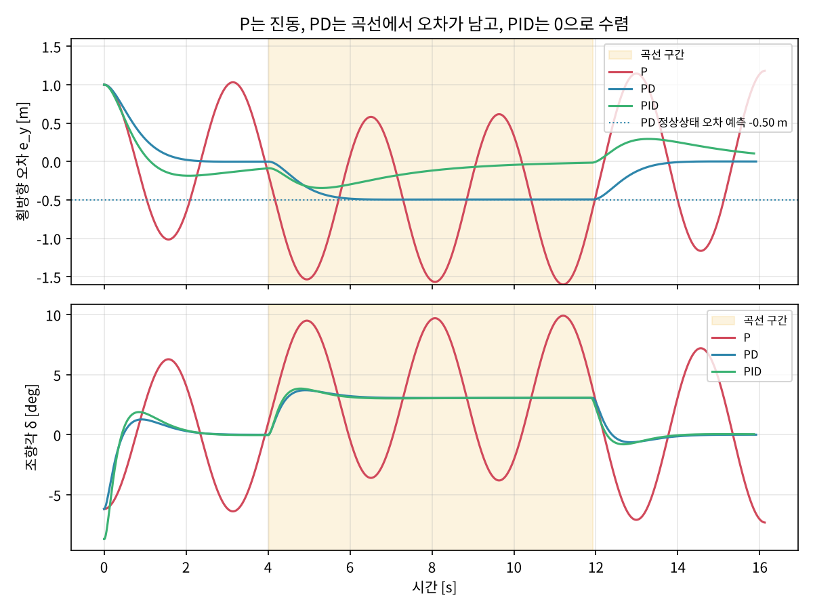
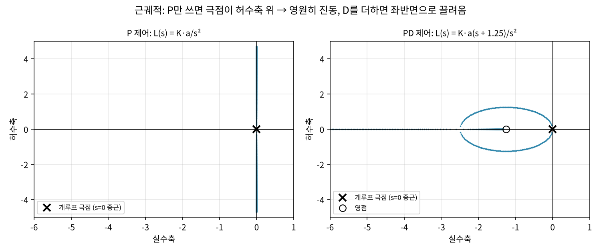

# 차량 차선 추종 제어 시뮬레이션 (Lane-Following Control)

자전거 모델로 차량을 수식화하고, 조향 제어기로 차선 중앙을 따라가게 만드는 프로젝트입니다.
PID에서 시작해 MPC까지 단계적으로 확장합니다.

## 목표와 로드맵

| 단계 | 내용 | 연계 과목 | 상태 |
|---|---|---|---|
| 1 | 기구학적 자전거 모델 + P/PD/PID 조향, 극점 배치로 게인 설계 | 응용수학, 제어공학, 제어시스템 설계 | ✅ 2026.11 |
| 2 | 동역학적 자전거 모델(타이어 횡력, 2자유도), 속도별 성능 비교 | 상태공간(자기학습), 제어공학 | 예정 |
| 3 | 곡률 피드포워드 + 피드백, 속도에 따른 게인 스케줄링 | 제어시스템 설계 | 예정 |
| 4 | 선형 MPC(조향각 제한을 제약조건으로) 구현, PID와 비교 | 최적제어(자기학습) | 예정 |

## 1단계 설계 요약

**모델** — 뒷바퀴 축 기준 기구학적 자전거 모델 (`src/vehicle.py`)

    x' = v cos ψ,   y' = v sin ψ,   ψ' = (v/L) tan δ

**오차 정의** — 차선 중앙에서 벗어난 거리 `e_y`, 방향 차이 `e_ψ` (`src/path.py`)

**선형화** — 오차가 작으면 sin x ≈ x, tan x ≈ x 이므로

    e_y'' = (v²/L)·δ − v²·κ    →    G(s) = E_y(s)/Δ(s) = a/s²,  a = v²/L

조향→횡오차는 **이중 적분기**이고, 도로 곡률 κ는 **외란**으로 들어옵니다.

**게인 설계** (`src/design.py`) — v = 10 m/s, L = 2.7 m (a = 37.04)

- PD: 특성방정식 `s² + aK_d s + aK_p = 0`을 표준 2차계 `s² + 2ζω_n s + ω_n²`에 맞춤
  (ζ = 0.8, ω_n = 2 rad/s → K_p = 0.108, K_d = 0.086)
- PID: `(s² + 2ζω_n s + ω_n²)(s + 0.5)`에 맞춤 → K_p = 0.151, K_i = 0.054, K_d = 0.100
- Routh 안정 조건 `K_i < aK_pK_d` 확인 (0.054 < 0.559)

## 1단계 결과

| 제어기 | 폐루프 극점 | 시작 오차 1 m 오버슈트 | 곡선(R=50 m) 정상상태 오차 |
|---|---|---|---|
| P | ±2j (허수축) | 101.6% (지속 진동) | 수렴 안 함 |
| PD | −1.6 ± 1.2j | 0.2% | −0.50 m (예측 −0.50 m) |
| PID | −1.6 ± 1.2j, −0.5 | 18.6% | → 0 |

- P만으로는 극점이 허수축에 놓여 끝없이 진동 → D항이 영점을 만들어 근궤적을 좌반면으로 끌어옴
- PD는 곡선에서 `e_y = −Lκ/K_p` 만큼 오차가 남음 (계산과 시뮬레이션 일치)
- PID의 적분항이 이 오차를 없애지만, 오버슈트가 늘어나는 대가가 있음
- 선형 모델 예측과 비선형 시뮬레이션이 잘 맞아, 선형화 설계가 유효함을 확인

## 실행

    pip install -r requirements.txt
    python run_stage1.py
