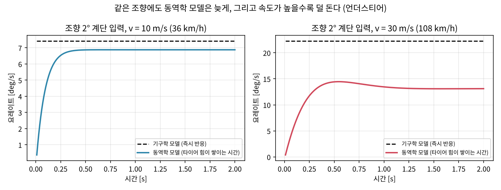
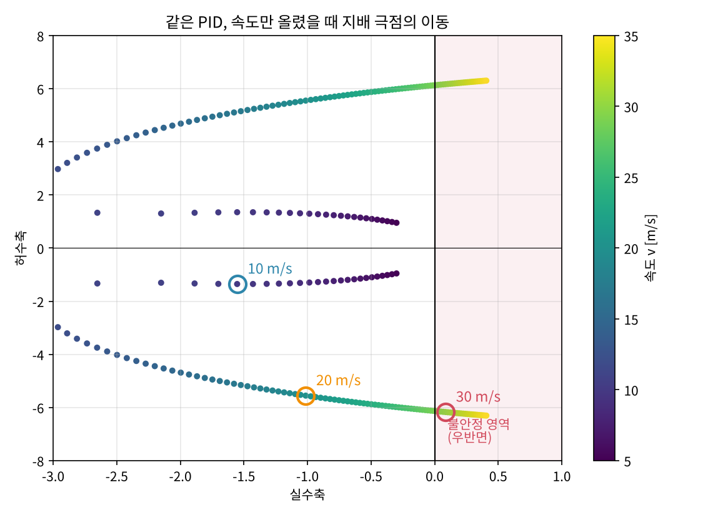
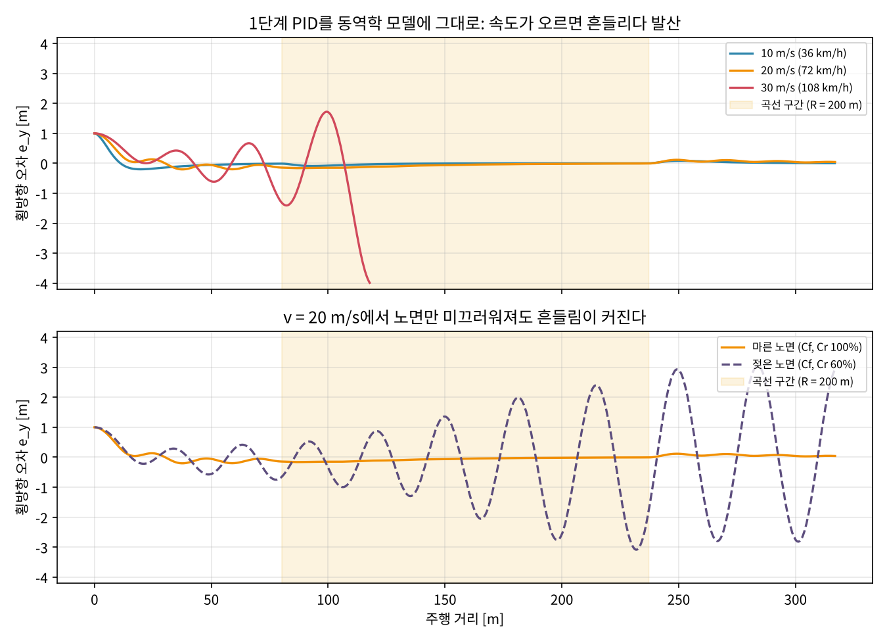

# 차량 차선 추종 제어 시뮬레이션 (Lane-Following Control)

자전거 모델로 차량을 수식화하고, 조향 제어기로 차선 중앙을 따라가게 만드는 프로젝트입니다.
PID에서 시작해 MPC까지 단계적으로 확장합니다.

## 목표와 로드맵

| 단계 | 내용 | 연계 과목 | 상태 |
|---|---|---|---|
| 1 | 기구학적 자전거 모델 + P/PD/PID 조향, 극점 배치로 게인 설계 | 응용수학, 제어공학, 제어시스템 설계 | ✅ 2026.11 |
| 2 | 동역학적 자전거 모델(타이어 횡력, 2자유도), 속도·노면별 성능 비교 | 상태공간(자기학습), 제어공학 | ✅ 2026.11 |
| 3 | 곡률 피드포워드 + 피드백, 속도에 따른 게인 스케줄링 | 제어시스템 설계 | 예정 |
| 4 | 선형 MPC → 속도·코너링 강성에 맞춰 바뀌는 MPC, PID와 비교 | 최적제어(자기학습) | 예정 |

## 1단계 설계 요약

**모델** — 뒷바퀴 축 기준 기구학적 자전거 모델 (`src/vehicle.py`)

    x' = v cos ψ,   y' = v sin ψ,   ψ' = (v/L) tan δ

**오차 정의** — 차선 중앙에서 벗어난 거리 `e_y`, 방향 차이 `e_ψ` (`src/path.py`)

**선형화** — 오차가 작으면 sin x ≈ x, tan x ≈ x 이므로

    e_y'' = (v²/L)·δ − v²·κ    →    G(s) = E_y(s)/Δ(s) = a/s²,  a = v²/L

조향→횡오차는 **이중 적분기**이고, 도로 곡률 κ는 **외란**으로 들어옵니다.

**게인 설계** (`src/design.py`) — v = 10 m/s, L = 2.7 m (a = 37.04)

- PD: 특성방정식 `s² + aK_d s + aK_p = 0`을 표준 2차계 `s² + 2ζω_n s + ω_n²`에 맞춤
  (ζ = 0.8, ω_n = 2 rad/s → K_p = 0.108, K_d = 0.086)
- PID: `(s² + 2ζω_n s + ω_n²)(s + 0.5)`에 맞춤 → K_p = 0.151, K_i = 0.054, K_d = 0.100
- Routh 안정 조건 `K_i < aK_pK_d` 확인 (0.054 < 0.559)

## 1단계 결과

| 제어기 | 폐루프 극점 | 시작 오차 1 m 오버슈트 | 곡선(R=50 m) 정상상태 오차 |
|---|---|---|---|
| P | ±2j (허수축) | 101.6% (지속 진동) | 수렴 안 함 |
| PD | −1.6 ± 1.2j | 0.2% | −0.50 m (예측 −0.50 m) |
| PID | −1.6 ± 1.2j, −0.5 | 18.6% | → 0 |

- P만으로는 극점이 허수축에 놓여 끝없이 진동 → D항이 영점을 만들어 근궤적을 좌반면으로 끌어옴
- PD는 곡선에서 `e_y = −Lκ/K_p` 만큼 오차가 남음 (계산과 시뮬레이션 일치)
- PID의 적분항이 이 오차를 없애지만, 오버슈트가 늘어나는 대가가 있음
- 선형 모델 예측과 비선형 시뮬레이션이 잘 맞아, 선형화 설계가 유효함을 확인

## 2단계: 동역학적 자전거 모델 — 1단계 PID는 어디서 무너지는가

**왜 필요한가** — 기구학 모델은 "바퀴가 가리키는 방향으로 그대로 간다"고 가정합니다. 실제 타이어는 옆으로 조금 미끄러지며(슬립각 α) 그에 비례하는 횡력 `F = C·α`를 냅니다(C = 코너링 강성). 속도가 높을수록 이 차이가 커집니다.

**모델** (`src/vehicle.py` `DynamicBicycle`, 무게중심 기준)

    α_f = δ − (v_y + l_f r)/v_x,   α_r = −(v_y − l_r r)/v_x
    m (v_y' + v_x r) = C_f α_f + C_r α_r          (횡방향 힘 평형)
    I_z r'           = l_f C_f α_f − l_r C_r α_r  (요 모멘트 평형)

차량 값: m = 1500 kg, I_z = 2500 kg·m², l_f = 1.2 m, l_r = 1.5 m, C_f = C_r = 80,000 N/rad (축당)

**오차 상태공간** (`src/design.py` `lateral_error_ss`) — 상태 `x = [e_y, e_y', e_ψ, e_ψ']`, 입력 δ, 외란 = 경로 곡률. `x' = Ax + Bδ + E·(v_x κ)` 형태의 4차 시스템이 됩니다. 1단계의 `a/s²`(2차)에 타이어가 만드는 극점 두 개가 더해진 셈입니다.

**실험** — 1단계에서 v = 10 m/s 기구학 모델로 설계한 PID 게인을 그대로 동역학 모델에 붙임 (`run_stage2.py`)

| 조건 | 결과 |
|---|---|
| 10 m/s (36 km/h) | 설계한 극점(−1.6 ± 1.2j)과 거의 같은 −1.55 ± 1.35j, 정상 완주 |
| 20 m/s (72 km/h) | 감쇠가 줄어 출렁이지만 완주 |
| 30 m/s (108 km/h) | 극점이 우반면으로 → 발산, 118 m에서 차선 이탈 |
| 20 m/s + 젖은 노면(C 60%) | 진동이 점점 커짐 (최대 오차 3.1 m) |

- 같은 게인으로 속도만 올리면 약 **29 m/s(104 km/h)에서 폐루프가 불안정**해짐 (python-control로 극점 계산)
- 원인: 속도가 오르면 타이어 힘이 쌓이는 시간(지연)이 상대적으로 커지고, 고정된 게인이 그 지연을 감당하지 못함
- 결론: **속도와 노면(코너링 강성)에 따라 제어기가 바뀌어야 한다** → 3단계(피드포워드·게인 스케줄링), 4단계(MPC)의 출발점

**한계** — 선형 타이어(F = C·α)는 슬립각이 작을 때(대략 5° 이내)만 맞습니다. 출발 순간의 큰 조향(시작 오차 1 m)에서는 앞바퀴 슬립각이 약 8.7°까지 커지고, 발산하는 경우는 수십 도에 이르러 실제와 다릅니다. 실제 차는 이보다 먼저 타이어 접지 한계에 걸립니다.

## 실행

    pip install -r requirements.txt
    python run_stage1.py   # 1단계
    python run_stage2.py   # 2단계
